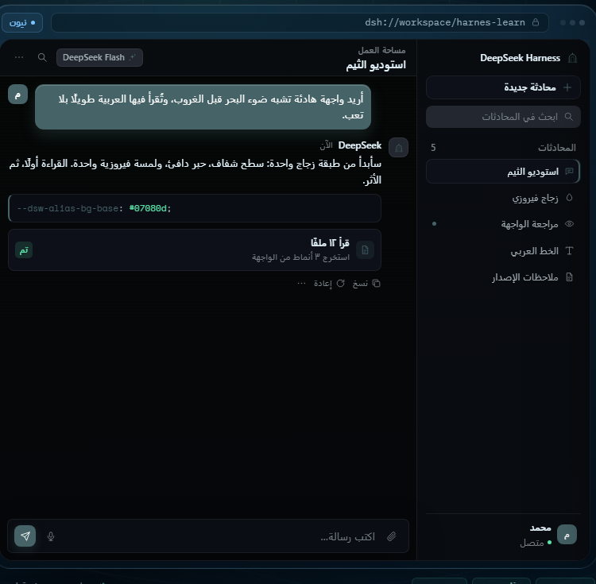

# نيون / Neon — DSH theme

بُني من موجز Mishkat الذي أرسلته. الهدف **DeepSeek Harness**، المحدد **دائم**، والأيقونات **Lucide 1.8**.
الملف الكامل للثيم + بلجن الأيقونات جاهزان.



## تحديثات أخيرة

- **خلفية الشات سوداء** `#000` في الوضع الداكن فقط؛ الهيدر، الشريط الجانبي، الكومبوزر، والقوائم بقيت كما هي.
- **أسماء الملفات بلون رسائل المستخدم** — استخدمت لون التمييز `--dsw-alias-brand-primary` (نفس اللون الظاهر لفقاعة المستخدم في تصميم نيون). أسماء ملفات الشريط الجانبي/الكومبوزر لم تُلمس.
- **حلقة الاستخدام** في البلجن: المتبقي من السياق (توكنز + نسبة) + حلقتان لاستخدام ٥ ساعات والأسبوع للموديل الحالي. تحتاج البلجن وإعادة تشغيل؛ لا تظهر في CSS فقط.

## الملفات

| الملف | الغرض |
|---|---|
| `neon-dsh.css` | الثيم الكامل + تعديلات الشات/أسماء الملفات، جاهز للصق في **الإعدادات → عام → CSS مخصص** |
| `theme-tweaks.css` | تعديلا الخلفية السوداء وأسماء الملفات فقط (مدمجان أيضًا في `neon-dsh.css`) |
| `usage-widget.js` | حلقة السياق المتبقي + حلقات 5h/الأسبوع (داخل البلجن) |
| `neon-terminal.css` | طبقة اختيارية لخلفية CRT (ضعها بعد الملف الأساسي) |
| `neon-icons.json` | ٢٤ رمز DSH (regular + medium) بصيغة SVG كاملة |
| `neon-theme.json` | نفس الثيم بصيغة JSON (16 خانة + الخطوط والأيقونات) |
| `neon-studio.png` | لقطة الاستوديو بالثيم المطبّق |
| `dsh-theme-neon/` | نسخة البلجن الكاملة (CSS + الأيقونات + الودجت) |
| `neon-brief.md` | الموجز الأصلي كما ولّدته |

## التركيب

### الأسرع — CSS فقط الآن

1. افتح DSH → **الإعدادات → عام → CSS مخصص**.
2. استورد `neon-dsh.css` أو الصق محتواه.
3. أعد تحميل الصفحة.

هذا يعطي **الألوان والخطوط والشكل + خلفية الشات السوداء + أسماء الملفات الملوّنة**؛ لا يستبدل الأيقونات ولا يضيف حلقة الاستخدام.

### الكامل — بلجن `dsh-theme-neon` (مثبّت بالفعل)

البلجن مثبّت في بروفايل `desktop`:

```
dsh-theme-neon : link:C:/Users/moham/workspace/tools/dsh-theme-neon
```

- يطبّق نفس CSS تلقائيًا (دائم) بما فيه خلفية الشات السوداء وأسماء الملفات.
- يستبدل ١٢ أيقونة (٢٤ رمزًا) في سبرايت DSH.
- يضيف **حلقة السياق المتبقي** (توكنز + نسبة) و**حلقتي 5h/الأسبوع** للموديل الحالي، بجانب مؤشر السياق.
- يعيد تطبيق الأيقونات بعد تبديل الوضع الفاتح/الداكن.
- **يحتاج إعادة تشغيل DSH** لأن حزمة العميل تُبنى عند بدء الخادم، ثم حدّث الصفحة.

بعد إعادة التشغيل، لا تحتاج لصق CSS؛ استخدم البلجن فقط (أو العكس). لا تجمع الاثنين بلا داعٍ.

### الرجوع الآمن

- `http://127.0.0.1:57192/?dsh-neon=off` — يعطّل CSS والأيقونات والودجت مؤقتًا.
- أو أزل حزمة `dsh-theme-neon` من **الإضافات** وأعد التشغيل.

## الاختيارات المطبّقة

- **داكن**: خلفية `#07080d`، سطح `#0d1018`، حبر `#e8f7ff`، تمييز `#466367`، تمييز-نص `#ffffff`.
- **فاتح**: خلفية `#eef7fb`، سطح `#ffffff`، حبر `#08131a`، تمييز `#0e7490`.
- **الحدود**: 25% hairline؛ `border-l2` = `rgba(…, 0.073)`.
- **الخطوط**: System Arabic + System UI، وSpace Mono للكود؛ 13px / 11px؛ سطر 1.6؛ عناوين 400.
- **الأيقونات**: Lucide، سُمك 1.8، حواف round، 12/12.
- **الشكل**: نصف قطر 7px، ظل deep، بلا زجاج (blur 0)، بلا حواف مضيئة، كثافة compact، حركة calm 220ms.
- **الخلفية**: طرفية — الطبقة الأساسية سوداء مسطحة؛ `neon-terminal.css` يضيف شبكة CRT اختيارياً لأن غلاف DSH معتم.

## ملاحظة

- DSH الأصلي يرسم فقاعة المستخدم بلون `--dsw-specific-bubble` (داكن `#10151c`)، وليس بلون التمييز. طلبك
  «نفس لون رسائل المستخدم» طُبّق على **لون تصميم نيون** الظاهر في المعاينة (التمييز `#466367`) لأنه اللون
  المرئي؛ لو تقصد لون الفقاعة الداكن نفسه، قل لي وأبدّله (لكنه سيكون خافتًا جدًا كنص).
- DSH لا يجعل الغلاف كله شفافًا من token CSS. لذلك الثيم الأساسي يحافظ على الخلفية السوداء الدقيقة، وطبقة
  الطرفية اختيارية. إذا أردت أن أدمجها في البلجن نفسه وأختبرها على واجهتك بعد إعادة التشغيل، قل لي.
